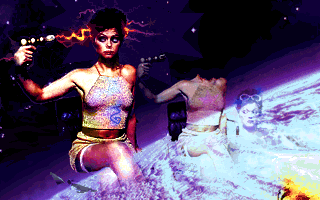
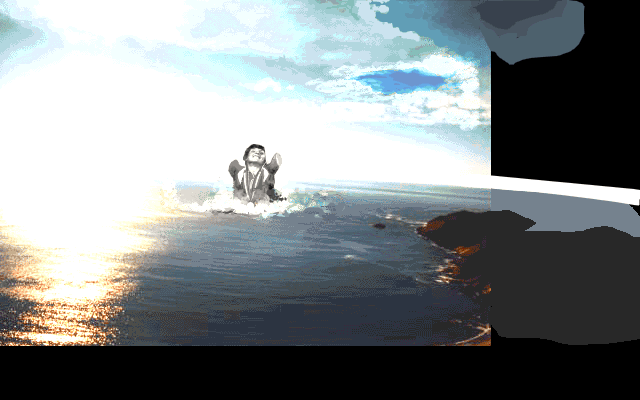
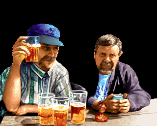
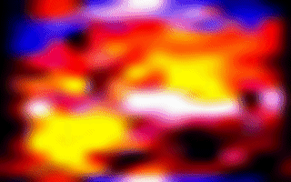
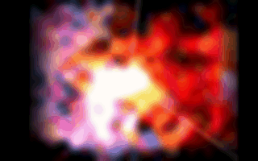
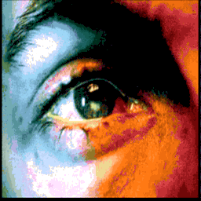
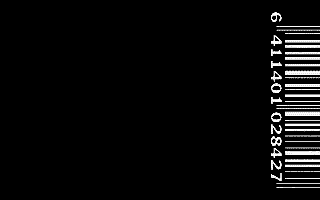
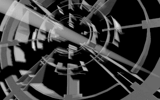
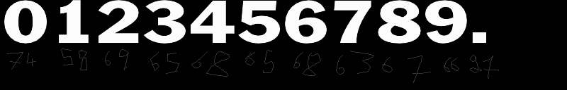

# The Secret Life of Mr. Black (Orange, 1997) - effects, art and timing

*The Secret Life of Mr. Black* by **Orange**: code Hoplite, music Dune (`KUSI.IT`), graphics Der Piipo, animation Frank (credits as listed in `README.md`). `DEMO.EXE` is
an MZ stub + PMODE/W 1.20 + an uncompressed LE image (Watcom C glue + hand-written asm effects); music is an Impulse Tracker module played by Indoor Music System 0.6;
all art lives in one container, `PETTERI`. Duration 183.3 s, 13 scenes. Everything below was read from the disassembly (`re/obj1.dis`) and checked against the
JavaScript port in `web/fx/`; "bit-exact" always means "0 differing pixels / DAC bytes against the Unicorn oracle over the frames the oracle recorded"
(see section 5 for what that does and does not cover).

## 0. At a glance

* **VGA mode 13h, 320x200, 256 colours**, except the intro (unchained 320x400). Pixels are not square: the player shows both at 4:3.
* **No x87 anywhere in the effect code** (the only FPU instructions in the image are the `fldcw` of the C runtime). All maths is 32-bit integer fixed point with a
  **4096-entry sine table shipped precomputed in the data object** (`0x206b68`, 10-bit amplitude, values -1023..1023, peak at index 1025; `cos(i) = T[i + 0x401]`, which is
  why every port does `T[i + 0x401]`; the table has 1026 extra entries after the 4096 so the +0x401 never wraps).
* **The sequencer is keyed on the IT order** (thresholds 2, 4, 6, 8, 10, 12, 15, 16, 18, 20, 22, 24, 25), so the timeline is the song position. Inside a scene the
  effect functions read a **time word** (`dword [0x200ab9]`, 65536 units per second of the IMS timer) and, for some, row and order.
* **Palette is part of the effect** in most scenes: the DAC is rewritten every frame (scaled by a fade table, or driven by sines) during the vertical retrace.
* Feedback buffers (blur + splat) are the dominant idea: scenes 2-6, 11, 12.

## 1. Timeline

| scene (port) | orders | start (s, oracle clock) | frame fn | what you see | seek class |
|---|---|---|---|---|---|
| fx00 intro | 0-1 | 0 | 0x10275f | noisy blue/white picture fading in, 320x400 | replay from 0 |
| fx01 eye warp + cards | 2-3 | 14.45 | 0x103d67 | warped eye picture, flashing photo cards, credits | pure f(w,order,row) |
| fx02 green rings | 4-5 | 28.76 | 0x102ce6 | blob rings with feedback | replay from scene start |
| fx03 particle cloud | 6-7 | 43.12 | 0x100b9c | white particle cloud + barcode strip | replay |
| fx04 particle ring | 8-9 | 57.38 | 0x1010e8 | red/orange ring around a dark hole | replay |
| fx05 spiral + pi | 10-11 | 71.71 | 0x10314d | blob spiral, scrolling digits of pi | replay |
| fx06 light trails | 12-14 | 86.05 | 0x101834 | swirling trail "flowers" | checkpoints every 25 calls |
| fx07 picture | 15 | 107.48 | none | still picture `cncd.scx` | static |
| fx08 photo + ghost | 16-17 | 114.61 | 0x103807 | panned photo, ghost silhouette fading in | pure f(t) |
| fx09 wire-frame room | 18-19 | 128.97 | 0x1054bf | rotating wire-frame room over a picture | pure f(t) |
| fx10 eye zoom | 20-21 | 143.29 | 0x105960 | zoomed/warped eye, fade | pure f(t) |
| fx11 starburst | 22-23 | 157.60 | 0x101d10 | white starburst with colour trails | checkpoints |
| fx12 blur dots | 24-25 | 171.92 | 0x106263 | 645 dots blur-fading, final fade | replay |

(Start times are the order-change clocks of the Unicorn run, `web/timetable.js`; the original ends with `int 21h/4Ch` at 183.3 s.)

## 2. Shared building blocks

**Time and angles.** Every effect turns the time word `w` into angle indices with `(w * k) >> 10 & 0xfff` (`imul eax,eax,k; sar eax,0xa; and eax,0xfff`); the multipliers
`k` are the per-effect "speeds" (e.g. scene 3: 6, 5, 7 for the offsets, 14, 11, -29 for the global rotation). Scene 6 and 11 count `w` *down*.

**Rotation by table.** One rotation of a point `(a, b)` by index `i`:

```js
const s = T[i], c = T[i + 0x401];
a2 = (a * c - b * s) >> 10;  b2 = (b * c + a * s) >> 10;      // 32-bit wrap like the CPU (Math.imul)
```

**The splat.** A particle is a 12-pixel star added into a byte buffer (`0x100856`, `0x1015de`): each of 12 offsets gets `+4` or `+8` (`+2/+4` in the second variant) only
while the byte is below a limit (`0x37`, resp. `0x3b`), so the buffer never overflows into the neighbour byte when read as dwords later.

```js
const SPL = [1,4, 2,4, 0x140,4, 0x141,8, 0x142,8, 0x143,4, 0x280,4, 0x281,8, 0x282,8, 0x283,4, 0x3c1,4, 0x3c2,4];
if (b[o] < lim) b[o] += inc;      // per pixel, from web/fx/cloud.js
```

**The blur.** The feedback blur is done on four pixels at a time: `((l + r + u + d) >> 2 & 0x3f3f3f3f)`, then subtract a shifted copy (decay) and mask again. It is only
correct because every byte stays <= 0x3f (so the dword adds never carry between pixels); the splat limit guarantees it. See the asm write-up.

**Shown frame = table lookup.** Scenes 4, 6, 11 show `tab[(buffer << 8) | picture]` where `tab` is a 16 KB `.shd` table: the buffer value (0..0x3f) selects a row, the
background picture pixel the column. So the glow is "lighting" of a photo through a precomputed palette-index table, and no RGB arithmetic exists in the demo.

## 3. Scene by scene

### 3.0 Intro (orders 0-1) - noise reveal of `pallo64.ani`
The frame function builds 4000 noise bytes with a 3-instruction LFSR (`ebp = rol(ebp + 0x9d, 11) ^ 0x9d`, byte = `(ebp & 255) * fade >> 8`), saturating-adds them to an
**80x50 window of `pallo64.ani`** (64 frames of 4000 bytes; the window moves by 4000 every 6144 time units, wrapping at 0x3e800 = 256000, but this branch never fires in the
oracle, see section 5), >>2, and enlarges 2x2 into a 160-wide buffer with averaged in-between pixels. The palette is `base * (256 - fade) >> 8`, `fade` from a
256-entry table indexed by order*64+row (it is 0 from about 2 s to 8 s, which is why the picture is static there: the noise is zero, the player is not stuck).
The 160x98 buffer is then expanded into **four VGA planes** (unchained 320x400, map mask via port 3c4h) with a brightness ramp `x`, `x - x/4`, `x - x/4 + x/8`, `x - x/4 + x/8`
on the four lines, and the page flip is a CRTC start-address write.
*Bit-exact*: 503 frames, 0 pixel and 0 palette differences, **given the recorded per-frame inputs** (`web/assets/intro_frames.json`, taken from the oracle).

### 3.1 Eye warp + title cards (orders 2-3, `fx01.js`)
A plane is rotated by three chained rotations (angles from `w`), the three corners `P0, P1, P2` are rotated, and a **41x26 grid of (u, v, shade) records** is walked by adding
per-column and per-row 3D steps. The depth of every grid point is displaced by a sum of five sines (wave), clamped to |z| >= 0x1000, the perspective is `0x800000 / z`, and
u, v come out as `x * k >> 8` plus a time offset. Each of the **40x25 cells (8x8 pixels)** is then filled with second-order interpolation of u and v (the row step of the
x step is itself stepped, `ddu`) and linear shade, and every pixel is `shade_table[shade][texture[v][u]]`.

```js
ua = im(x, k) >> 8; va = im(y, k) >> 8;           // k = 0x800000 / ec  (cdq; idiv)
dux += ddu; U += dul; Sh += dsy;                  // per scanline of a cell
scr[o + x] = shade[(s >> 8 & 255) << 8 | tex[(v >> 8 & 255) << 8 | (u >> 8 & 255)]];
```

On top, six **overlay cells** (64000 bytes each) selected by a 128-entry timeline (`order*64+row`) are applied as `scr = shade[(overlay >> 2) << 8 | scr]`: one is a flat 127 (darken to
black), the other five are the photo cards `wife, son, daugh, andi, all` (section 4). The DAC is the source palette times `fade` (`min(w >> 8, 0x100)`, then
`(0x40 - row) * 8` from order 3 row 0x20, 0 in order 4).
*Bit-exact*: 334 frames, 0 diffs, given the original's own `(w, order, row)` per call. It is a pure function of those three, so seek is free; in the player `w` and the row come from the music clock.
**Texture and palette are those of `zrva.scx`** (verified, section 4): the eye of scenes 1 and 10 is the same 256x256 picture.

### 3.2 Green rings (orders 4-5, `fx02.js` + `blob.js`)
Per call: update 12 parameters from the *previous* call's time word (`0x10300a`), then **256 additive, saturating blits of a 32x32 blob** into buffer A. Blob `n` sits at
`(sin(i)*0x64/1024 * r >> 11 + 0x90, cos(i)*0x50/1024 * r >> 11 + 0x54)`, `i` advances 0x30 per blob and `r` is a sum of two sines (so the 256 blobs trace a wobbling ellipse
of 100x80 half-axes: the "rings"). The blob itself is generated at init (`0x102c16`): `63 - (min(x^2 + y^2, 127) >> 1)` for x, y in -16..15, a radial cone.
The shown frame is `A/2 + tahta.raw` (saturating), then A is **downscaled by taking every second pixel/row, halved, and tiled 2x2** into B, and A/B swap: the picture
feeds back on itself at half size, which produces the receding rings. DAC = `pal * fade[row] >> 8`.
*Bit-exact*: 201 frames incl. DAC, **given the original's time word per call**; the player replays from the scene start with the oracle's mean call spacing (4682.3 units), so
frame *times* are approximate.

### 3.3 Particle cloud (orders 6-7, `fx03.js`, `cloud.js`)
Up to 2048 points from a table of uniform coordinates (-0x7fff..0x8000, filled at init `0x100ab2` by the same add/rol/xor LFSR with rol 10) are rotated by **six chained
rotations**: three whose angle depends on the distance to the rotation axis (a twist: `d = (x+o)^2 + y^2 >> 19`, clamped to 0x1000, `e = ((0x1000 - d)^2 >> 11)^2 >> 11`, angle =
`e * sine >> 15`), then three global ones from `w`. Perspective with `cdq; shl eax,15; idiv ecx` (the shift drops the high bits for |v| >= 65536; the port emulates this),
x scaled by 5/4, splat at `(+0x9f80 >> 8, +0x6380 >> 8)`, number of points `min(0x800, w*32 >> 10 + 1)` (the cloud grows). Then blur (decay `>> 2`) and swap. Output =
buffer + `koodi.raw` as a **dword add with carries** (deliberate or tolerated, bytes cross-talk), with a palette driven by three sines (`(T[i] + 0x4400) * e >> 13`, clamped 0x3f).
*Bit-exact* 521 frames given (w, order, row); player: calls DT = 1793.2 units apart.

### 3.4 Particle ring (orders 8-9, `fx04.js`)
Same cloud, but the points are first shifted by `w * 0x80` (with 16-bit wrap), the depth gets `+ (x^2 + y^2) >> 14` plus an offset that drifts in order 9 from row 0x30, giving the
ring and the dark hole. Output `tab[(buffer << 8) | picture]` with `kuva.shd` / `kuva.scx` (red/orange palette from the picture). *Bit-exact*, 502 frames (a first attempt differed on
105 pixels because the 16-bit wrap was skipped when `w*0x80` was exactly 0; fixed).

### 3.5 Blob spiral + pi scroller (orders 10-11, `fx05.js`)
Same blob blitter as 3.2, but the radius shrinks by 4 per blob (spiral), the shown frame is A/2 and, for rows 90..159, a **scroller** is added. The scroller (`0x103542`)
copies glyph columns from the font strip `f1.raw` (800 bytes per row, 64 rows used) into a 384x64 strip buffer; glyph widths and the text (digits of pi) are tables in the data object;
the position accumulates `w >> 14` per call. The feedback is downscaled bottom-up with `/2 - /2/32` (slight decay). *Bit-exact* 201 frames given (w, row); the first blob of
every call uses raw unmasked table indices that can point below the sine table, so the data object dumped at the first call is used: verified only over this run.

### 3.6 Light-trail flowers (orders 12-14, `fx06.js` + `trail.js`)
64 passes x 64 points per frame, each point's three angles from an LCG restarted at `0x5c23` every pass (so every pass draws the *same* shape, rotated differently), three rotations
by those angles then three by pass angles built from the previous frame's state (sines of `w*{1,-3,2} >> 10` and accumulators of `w - previous w`), perspective with `shl 16`, splat
`0x1015de` (limit 0x3b), blur with decay `>> 3`, output through `kuva2.shd`/`kuva2.scx`. Because the state accumulates, the port keeps checkpoints every 25 calls.
*Bit-exact* 750 frames.

### 3.7 Picture (order 15, `fx07.js`)
No frame function at all: init `0x10095e` sets mode 13h, loads `cncd.scx`, writes its 6-bit palette to the DAC and copies 64000 bytes to VRAM. Matches golden `t0110` exactly.

### 3.8 Photo + ghost (orders 16-17, `fx08.js`)
A **640x400 photo** (`k1.scx`) is shown through a 320x200 window panned by sines (`x = ((S[a]+S[b]+S[c]+S[d])>>2 + 0x400) * 0xab >> 11`, `y = (...) * 0x91 >> 11 + 0x32`). A 320x256
**ghost** picture (`k2.scx` pixels) is blended over it at `y0 + 10 + (cos(t >> 8) >> 4)` through a **5-bit mask** (`alffa.raw >> 3`, a silhouette of two men): per pixel
`T2[T1[(32-m)*256 + bg] * 256 + T1[m*256 + g]]`, i.e. a cross-fade done with two 16 KB tables and a 64 KB one, no multiplications. *Bit-exact*, 556 frames, pure function of `t`.

### 3.9 Wire-frame room (orders 18-19, `fx09.js`)
96 vertices and 96 edges (static tables in the data object, `0x214b22`, `0x215422`) are rotated by three angles (`3t, 2t, 7t >> 10`), x and y doubled, z offset `t >> 10`, edges sorted by z,
clipped against z = 1 and drawn by a Chebyshev line routine (n = max(|dx|, |dy|) >> 8 steps) that **splats the same 12-pixel star as the particle scenes** into a line buffer
(cleared each frame); output `T[(line << 8) | picture]` with the `kuva3` table/picture. *Bit-exact* 501 frames given `t`; pure function of `t`.

### 3.10 Eye zoom (orders 20-21, `fx10.js`)
A **81x51 grid** of warped texture coordinates over the 256x256 `zrva.scx`: two radial bulges at (0x5000, 0x3200) and (0xf000, 0x9600) (strength `(1 - r^2/256)^8` by three squarings in
8.8 fixed point), rotation by an angle from four sine phases, scale `amp = min(0x10000, 64t >> 10)`. Each **4x4 cell** is filled by bilinear-ish stepping between its four grid corners and the pixel is a straight `tex[y>>8 & 255][x>>8 & 255]` read.
The fade from order 21 row 32 telescopes: `level = max(0, 0x40000 - (w - 701391))`, DAC = `pal * (level >> 10) >> 8`. *Bit-exact* 501 frames incl. DAC, pure function of `t` (the constant 701391
comes from the oracle).

### 3.11 Starburst (orders 22-23, `fx11.js`)
Same engine as 3.6 with 64 passes x 128 points, LCG seed 1, radius `(0x1000 + sum k^2) >> 5`, perspective `shl 8`, blur decay `>> 2`, `kuva3` table. The last ~0.1 s runs into order 24: the DAC
becomes `pal * f >> 8` with `f = table[row] + ((sine[(w>>7) & 0xfff] - 0x400) >> 5)`, clamped at 0. *Bit-exact* 334 frames incl. that fade (verified with a second oracle run to 172 s).

### 3.12 Blur dots (orders 24-25, `fx12.js`)
Each call blurs buffer A into B with raw **unaligned dword adds that carry across bytes** (`[-4] + [+4] + [-0x500] + [+0x500]`, i.e. neighbours at +-1 pixel and +-4 rows), `>> 2`, minus a shifted
copy; then 645 dots `(x, -y) * (0x2000 - min(0x2000, w >> 7)) >> 12 + (160, 100)` each add one of 16 cycling 16x16 sprites (dword adds, with carry); the dots converge to the centre as `w`
grows. In order 25 the palette follows `fade[row]`. *Bit-exact* 795 frames incl. DAC given (w, row, order); the fade row in order 25 is derived from time in the player (+-1 call).

## 4. Art: images, tables, fonts, sprites, 3D

Everything lives in **`PETTERI`** (1.7 MB, no compression): `u32 count (23)`, then 23 x `{char name[12]; u32 offset}` (offsets relative to the end of the directory at 0x174), files back to back.
`DEMO.EXE` opens it once and finds files by comparing the 12-byte name (`0x100231`). `re/petteri.py` unpacks it to `re/assets/` and renders previews. The EXE also holds the name `anim176.ani`
(`0x20f2c6`) but **no such file exists in PETTERI**. Previews are in [`figures/`](figures/); palettes are 6-bit VGA DAC values (the port scales `v*255/63`), grey previews of the
palette-less `.raw` files are stretched to full range and are *not* in their real colours.

### 4.1 Pictures (RIX3 `.scx`: `"RIX3"`, u16 w, u16 h, flag 0xaf, 768-byte palette at +10, w*h pixels at +778)
| file | size | colours actually used | used by | preview |
|---|---|---|---|---|
| `cncd.scx` | 320x200 | 251 | scene 7 (picture, order 15) |  |
| `k1.scx` | 640x400 | 119 | scene 8, the panned photo |  |
| `k2.scx` | 320x256 | 250 | scene 8, the ghost (same palette as k1) |  |
| `kuva.scx` | 320x200 | 237 | scene 4 background |  |
| `kuva2.scx` | 320x200 | 218 | scene 6 background |  |
| `kuva3.scx` | 320x200 | 230 | scenes 9 and 11 background (verified: scene 9's picture, table and palette are exactly kuva3) |  |
| `zrva.scx` | 256x256 | 232 | scenes 1 and 10 (texture and palette identical in both ports' data) |  |

Note: `re/NOTES.md` attributes scene 1's eye to `k1.scx`; the data exported for scene 1 shows the texture is `zrva.scx` (compared byte for byte), and `k1.scx` is the scene 8 photo.

### 4.2 Headerless 8-bit images (`.raw`, no palette: the palette comes from the scene)
| file | size | distinct values | role | preview |
|---|---|---|---|---|
| `wife.raw`, `son.raw`, `daugh.raw`, `andi.raw`, `all.raw` | 320x200 each | 14, 14, 16, 15, 15 (up to 255) | the five photo/title cards of scene 1, byte-identical to the overlay cells (value >> 2 indexes the shade table) |   |
| `koodi.raw` | 320x200 | 5 (0..7) | barcode strip added in scene 3 |  |
| `tahta.raw` | 320x200 | 53 (max 58) | scene 2's background (verified: the "kk" table in the port is this file) |  |
| `alffa.raw` | 320x256 | 16 (multiples of 17) | scene 8 ghost mask, loaded with `>> 3` (`0x1037bb` loop, 0x14000 bytes) |  |
| `f1.raw` | 800x128 | 24 | scene 5 font: top 64 rows are the digits `0123456789.`, bottom half is faint handwriting not read by the scroller |  |

The photo cards are drawn in 15-16 grey levels and "MY WIFE is a man," style captions; the demo never needs colour for them because the shade table maps (level, pixel) to a palette index.

### 4.3 Tables and animation
* `*.shd` (16384 bytes = 64 rows x 256): `kuva.shd`, `kuva2.shd`, `kuva3.shd`, `zrva.shd`, `kk.shd`. Row = brightness 0..63, column = source palette index. In scene 1 the first 16 KB of the 64 KB shade table equal `zrva.shd`.
* `kk.mix` (65536): a 256x256 table (246 distinct values), `kk.shd` is a 16 KB table with 246 distinct values; their exact consumers were not traced here.
* `pallo64.ani` (256000 = 64 frames of 80x50 bytes, 256 distinct values): the intro's light/noise source (offset step 4000, wrap 0x3e800, from the code).
* Generated, not stored: the **blob** (32x32 cone, `63 - (min(x^2+y^2,127) >> 1)`) of scenes 2 and 5, the 2048 uniform point table (LCG at init `0x100ab2`), and the sine table (stored in the data object).

### 4.4 3D models
**There are no mesh files.** `PETTERI` contains no 3D data and the EXE has no object loader. The only "geometry" is: the **wire-frame room** (96 vertices x 3 int32 and 96 edges x 2 int32 in the
data object, exported to `web/assets/s18.bin`), the **8x8-pixel cells of grids** (scene 1: 41x26, scene 10: 81x51) built procedurally, and the **procedural point clouds** (scenes 3, 4, 6, 11). The
6-bit palettes of every scene come from the `.scx` pictures, except the intro (768 bytes at `0x20f2ea`, `web/assets/intro_pal.bin`) and the sine-driven palette of scene 3.

## 5. What is bit-exact, what is approximate

* **Pixels of a frame: exact** for all 13 scenes, *given the original's own inputs for that frame* (time word, row, order; oracle = the original code under Unicorn).
* **Timing is not**: the original's frame times depend on the machine; the oracle's clock is a model (20 ns/instruction + 1 us/port access). The player derives the time word from the
  music clock with the oracle's *mean* call spacing, so *when* a feedback frame appears is approximate; scenes 2-6, 11, 12 are replayed from the scene start.
* The intro's scroll branch is ported but never fires in the oracle (untested). Scene 5's first blob reads live memory. The sync of libopenmpt to IMS is approximate.
* Scenes 6 and 11 count `w` downwards in the original; the port reproduces that.
